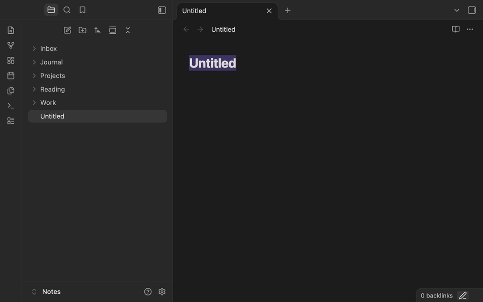

# Alyok Autotag

Obsidian plugin that tags notes by folder. You say that notes in `Work` get `#work`, and from then on every note created in `Work` or moved there gets the tag. Works on desktop and mobile.



## How it works

A rule is a folder plus tags. It covers the folder and everything inside it, so with rules for `Projects` and `Projects/Alpha` a note in `Projects/Alpha` gets the tags of both.

- A new note gets the tags of its folder. If no rule matches, it gets `#new`, so unsorted notes are easy to find.
- When a note is moved to another folder, the tags of the old folder go away, the tags of the new one are added, and `#new` is removed.
- Renaming a note changes nothing.
- When you rename or move a folder, its rules follow it.

Tags go either to a block at the end of the note or to the `tags` property.

The block looks like this:

```
<!-- Alyok Autotag -->
#work
#new
```

The plugin rewrites the block, so don't keep your own tags in it. Whatever you write below the block stays.

With the `tags` property the plugin only adds and removes the tags of its rules, your other tags are left alone. If you switch from the block to the property, run "Apply to all notes" once and the tags move over.

## Rules

In the settings: pick a folder and type the tags, `#tag1 #tag2` or `tag1, tag2`.

From the file explorer: right-click a folder (long-press on mobile) and choose "Autotag rule". On a phone this is the fastest way. When you save a rule there, the notes already in the folder get the new tags right away, and tags you removed from the rule are taken off them.

"Rules from folder names" makes a rule for every folder with the folder name as the tag, either the name itself (`#Design`) or the full path as a nested tag (`#Projects/Work/Design`). "Folders without rules" shows what's left, tap a folder to give it a rule.

## Other settings

- Tag for new notes: `new` by default.
- Creation time tag: new notes get a tag like `#2025-08-31-14-35`. It stays the same when the note is moved.
- Name new notes by time: an untitled note gets a name like `2025-08-31-14-35`. Daily notes and notes created from a link keep their names.
- Skipped folders: notes there are never touched. Put your templates folder here.

Excalidraw drawings and Kanban boards are always left alone. A note only counts as new when it's created on this device, files that come in through sync are not tagged as new.

## Commands

- Retag current note
- Apply rules to all notes
- Show folders without rules
- Rule for the current folder

## Installation

In Obsidian: Settings, Community plugins, Browse, search for Alyok Autotag. Until it shows up there, use one of the ways below.

With [BRAT](https://github.com/TfTHacker/obsidian42-brat), this works on mobile too: "Add beta plugin" and paste `24tiy/Alyok-Autotag`.

Manually: download `main.js`, `manifest.json` and `styles.css` from the [latest release](https://github.com/24tiy/Alyok-Autotag/releases/latest) into `<vault>/.obsidian/plugins/alyok-autotag/`, then turn on Alyok Autotag in Settings, Community plugins.

Needs Obsidian 1.8.7 or newer.

## Building

```
npm install
npm run build
npm run lint
```

`npm run lint` runs the official Obsidian ESLint rules, the same ones the community directory checks.

## Changelog

### 1.1.1

- The interface is English only, the Russian translation is gone.

### 1.1.0

- Tags can go to the `tags` property instead of the block.
- Skipped folders.
- "Autotag rule" in the folder menu. Saving a rule there also retags the notes already in the folder.
- Commands.
- Rules follow renamed and moved folders.
- Settings reworked for phones: long folder names and tags are no longer cut off.
- Fixed: text written below the tag block was deleted when the note was moved.
- Fixed: renaming a new note removed `#new`.
- Fixed: files coming in through sync were tagged as new notes.
- Fixed: Templater folder templates didn't apply to new notes.
- Fixed: the plugin could wipe text you had just typed in an open note.
- Fixed: "Name new notes by time" renamed daily notes, notes created from links and drawings.
- Fixed: folder names with spaces gave broken tags.

### 1.0.0

First release: folder rules, `#new`, retag on move, creation time tag, naming by time, folders without rules, rules from folder names, apply to all notes.

## License

[MIT](LICENSE)
